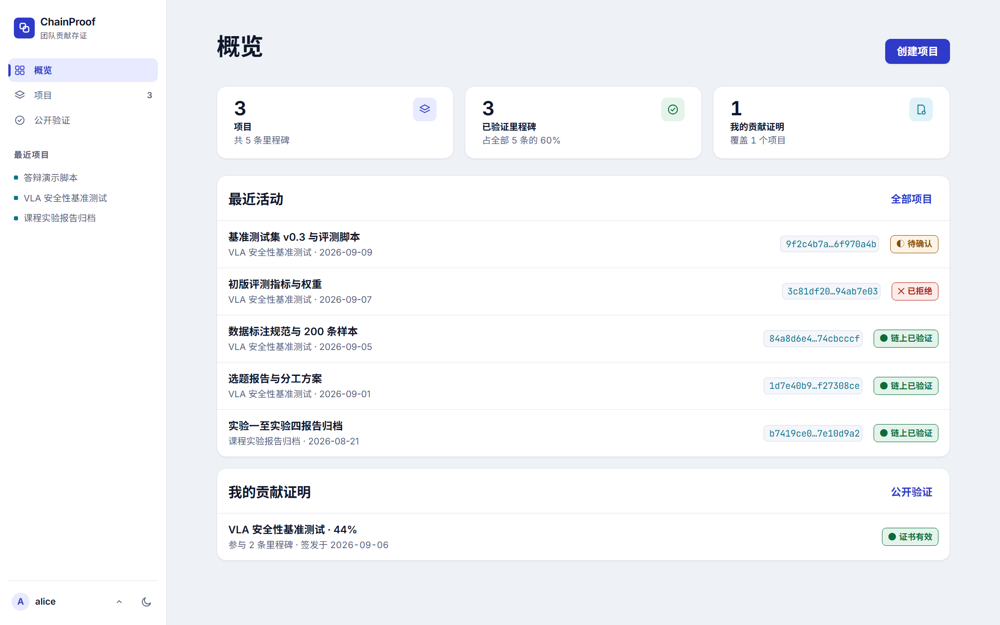
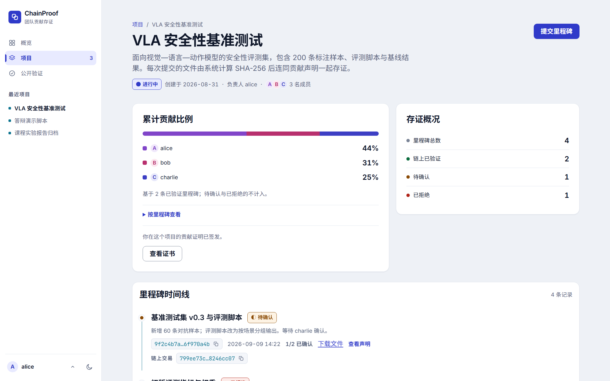
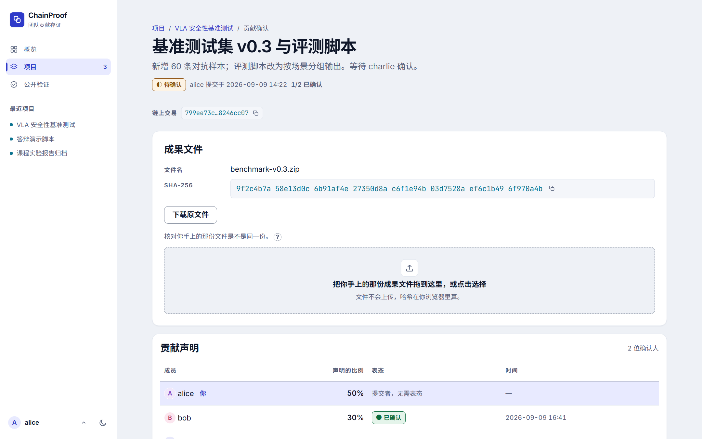
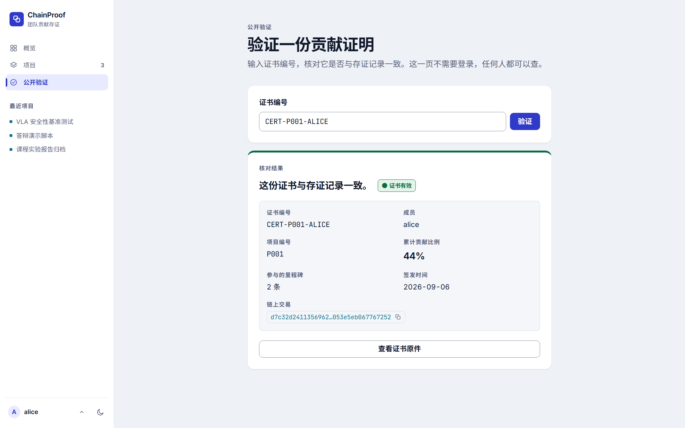

# ChainProof 项目介绍

> 基于 Hyperledger Fabric 的团队成果与贡献可信存证平台
> 「区块链技术应用实践」课程大作业 · 2026 秋

---

## 1. 要解决的实际问题

小组作业、竞赛和科研协作里，最常见的争议不是技术问题，而是：

- **谁做了什么**：贡献比例往往在项目结束后靠回忆和协商决定，缺少过程证据。
- **成果什么时候完成**：文件经过多次修改，事后很难证明某个版本在某个时间点已经存在。
- **结论会不会被改**：贡献表、聊天记录、共享文档都可以被任意一方事后修改。
- **外人如何相信**：老师、评委或用人单位拿到一份「贡献说明」，没有办法独立核实。

现有工具各有缺口：Git 记录只覆盖代码，提交人可以改写历史，也不表达「其他人是否认可」；共享文档和表格由管理员单方面控制；纸面签字无法和具体成果文件绑定。

ChainProof 的目标是：**把「成果文件 + 贡献比例 + 其他成员的确认」作为一个整体存证到联盟链上，并能生成可被任何人公开核验的贡献证明。**

## 2. 技术方案

### 2.1 总体架构

```text
浏览器（Vue 3 + Vite）
   │  REST / JSON + multipart，X-Member-Id 标识演示身份
   ▼
Express 后端（Node.js）
   │  参数校验 · 服务端 SHA-256 复算 · 链下文件托管 · 成员鉴权 · 错误映射
   ├──► 本地文件存储（原始成果文件，链下）
   ▼
Fabric Gateway SDK（gRPC + TLS）
   ▼
Hyperledger Fabric 2.5 test-network（2 个组织 + 1 个 orderer，通道 chainproof）
   ▼
ChainProofContract（JavaScript Chaincode）
```

### 2.2 链上 / 链下边界

区块链只存放真正需要「防篡改、可追溯、多人共同确认」的数据：

| 链上（Fabric 世界状态 + 交易历史） | 链下（后端本地存储） |
|---|---|
| 项目与成员列表 | 原始成果文件 |
| 里程碑与文件 SHA-256 | 界面偏好、演示身份 |
| 贡献比例声明 | 前端缓存 |
| 每位成员的确认 / 拒绝结果 | |
| 里程碑状态与关键交易 txId | |
| 贡献证明记录 | |

原始文件不上链，既避免了账本膨胀，也避免把成果内容暴露给所有背书节点；链上的哈希足以证明「这份文件就是当时被确认的那一份」。

### 2.3 核心机制

**① 前后端双算 SHA-256**
浏览器选中文件后先在本地计算 SHA-256 并展示给用户；上传后后端对原始字节独立复算，两者一致才写链，否则返回 `FILE_HASH_MISMATCH`。写入 Fabric 的哈希以服务端结果为准。确认人和外部验证者可以把手里的文件拖进页面，在浏览器本地重算并与链上哈希比对，文件不需要再次上传。

**② 独立成员确认状态机（链码强制）**
- 创建里程碑时，链码把「除提交者外的全部项目成员」按字节序排序后保存为 `requiredConfirmerIds` 快照。
- **提交者不能确认自己的里程碑**（`SUBMITTER_CANNOT_CONFIRM`），否则一个人就能给自己写 100% 并自证。
- 每人只能表态一次，不能改票（`ALREADY_DECIDED`）。
- 全部确认人同意 → `VERIFIED`；任意一人拒绝 → 立即 `REJECTED`；关闭状态不再接受表态（`MILESTONE_CLOSED`）。

规则写在链码里，而不是只写在后端或前端，因此即使绕过 Web 界面直接调用 Fabric，也无法跳过确认。

**③ 确定性的贡献统计**
累计贡献只统计 `VERIFIED` 里程碑，每条等权。为了让多个背书节点、后端和前端 Mock 算出完全相同的结果，全程使用整数 `div/mod` + 最大余数法，余数相同时按 `memberId` 的 UTF-8 字节序分配，保证总和严格为 100%，不使用浮点数和本地化排序。

**④ 贡献证明与公开验证**
成员累计比例大于 0 时可签发证书，证书包含参与的里程碑快照和链上 txId；同一成员在同一项目只签发一次（幂等）。任何人可在无需登录的公开验证页输入证书编号，得到 `VALID` 或 `NOT_FOUND`。

**⑤ 成员级访问控制**
项目、里程碑详情和原文件下载都要求请求者是项目成员；非成员下载原文件返回 403。

### 2.4 智能合约接口

`ChainProofContract` 提供 14 个事务函数：

| 类别 | 函数 |
|---|---|
| 项目 | `CreateProject` `GetProject` `GetAllProjects` `ProjectExists` `GetProjectHistory` |
| 里程碑 | `CreateMilestone` `GetMilestone` `GetProjectMilestones` `ConfirmContribution` |
| 统计 | `GetProjectContributions` |
| 证书 | `IssueCertificate` `GetCertificate` `GetCertificates` `VerifyCertificate` |

后端对应 15 个 REST 接口，契约见 [API.md](API.md)。

### 2.5 技术栈

| 层 | 技术 |
|---|---|
| 前端 | Vue 3、Vite、Vue Router、浏览器本地 SHA-256（Web Crypto，非安全上下文自动降级为纯 JS 实现） |
| 后端 | Node.js 22、Express 5、multer、@hyperledger/fabric-gateway |
| 区块链 | Hyperledger Fabric 2.5.16、fabric-contract-api 2.5.8、LevelDB |
| 工程 | GitHub Issue / PR / Review、GitHub Actions 三条 CI、WSL2 + Docker |

## 3. 团队分工

| 角色 | GitHub | 主要职责 |
|---|---|---|
| A：前端 / 产品 | @Darioyy | 9 个页面与组件、Mock 数据、响应式与视觉、前端自检脚本、原文件下载与本地核验 |
| B：区块链 / 智能合约 | @Hmq901 | Fabric 网络搭建、核心链码与状态机、合约单元测试、真实网络集成脚本、Demo 种子脚本 |
| C：后端 / 集成 · 项目统筹 | @Looffeeuu | Express API、Fabric Gateway 集成、双 SHA-256、成员鉴权、前后端联调、CI、Issue 拆分与 Review |

逐条可追溯的 Issue / PR / Review 记录见 [CONTRIBUTIONS.md](CONTRIBUTIONS.md)。

## 4. 最终成果

### 4.1 功能

MVP 需求文档中的 FR-01 ~ FR-10 全部实现，并通过真实 Fabric 网络验收：

- 项目创建与成员管理
- 里程碑提交、文件上传、前后端双算 SHA-256
- 贡献比例声明（整数，总和 100%）
- 独立成员确认 / 拒绝，提交者不能自我确认
- 项目时间线（含每条记录的链上 txId）
- 贡献统计面板（最大余数法）
- 贡献证明签发、证书页、打印 / 存为 PDF
- 公开验证页（`VALID` / `NOT_FOUND`）
- 原文件下载 + 浏览器本地哈希核验
- 成员级访问控制
- Demo 一键重置：`npm run demo:reset` 重建账本并写入 3 个项目、6 个里程碑、2 张证书

### 4.2 质量保障

| 项 | 结果 |
|---|---|
| 链码单元测试（Jest） | 4 个测试套件，128 项全部通过 |
| 后端单元测试（node:test） | 34 项全部通过 |
| 前端自检（`npm run check`） | 对比度、文案、间距、路由、数据、组件、SSR 渲染、契约、降级、异常数据、浏览器流程等 15 组检查 |
| 真实链路冒烟 | `smoke:projects` / `smoke:milestones` / `smoke:week3` 在真实 Fabric 上通过 |
| 前后端契约 | `check:contract` 对真实后端通过 |
| CI | Backend / Frontend / Chaincode 三条 GitHub Actions，每个 PR 必须全绿才合并 |
| 仓库安全 | 无私钥、Fabric 证书、`.env`、上传文件入库（仅 `.env.example` 模板） |

### 4.3 界面

| 概览 | 项目详情（贡献面板 + 时间线） |
|---|---|
|  |  |
| **贡献确认（下载原文件 + 本地核验）** | **公开验证** |
|  |  |

> 截图来自前端 Mock 模式，与真实接口数据结构一致；答辩现场使用真实 Fabric 网络演示。

## 5. 开发过程

| 周 | 主要交付 | 关键 Issue / PR |
|---|---|---|
| 第 1 周 | Fabric 网络、核心链码、后端基础、前端 9 个页面 | #1 #2 #3 #4 / PR #8 #10 #12 #13 |
| 第 2 周 | 里程碑上传、双 SHA-256、确认闭环、真实网络脚本修复 | #5 / PR #18 #21 #22 |
| 第 3 周 | 时间线、贡献面板、证书签发与公开验证 | #6 / PR #23 |
| 第 4 周 | 独立确认、原文件下载与鉴权、Demo 一键重置、换行规范、交付材料 | #24 ~ #27 #7 / PR #28 ~ #32 |

开发中途发现并修复了一个影响项目核心主张的漏洞：最初规则是「全部 contributor 确认即 VERIFIED」，一个人可以提交只写自己 100% 的里程碑并自己确认。第 4 周把确认人改为「除提交者外的全部成员」，并在链码层强制执行（Issue #24 / PR #28）。

## 6. 局限与后期改进

| 当前局限 | 改进思路 |
|---|---|
| 演示身份通过 `X-Member-Id` 切换，没有真实登录 | 接入 Fabric CA，为每位成员签发独立身份，由链码通过 `ctx.clientIdentity` 识别调用者，签名本身即确认凭据 |
| 所有交易由后端以同一个 Org1 用户提交 | 每个成员 / 学院 / 评审机构作为独立组织，背书策略要求多组织共同背书 |
| 原文件只保存在后端本地 | 接入对象存储或 IPFS，按哈希寻址，链上只保留 CID |
| 一旦拒绝即终止，无法修改后重提 | 支持基于原里程碑的新版本提交，保留版本链 |
| 每条里程碑等权统计 | 允许项目创建时约定里程碑权重，并同样上链 |
| 证书依赖平台验证页 | 证书附带链上交易证明和可离线校验的二维码 / 签名 |
| 本地单机 test-network | 部署到多主机联盟网络，加入监控与备份 |

## 7. 总结与思考

1. **区块链的价值在于「多方共同认可的记录」，而不是「存东西」。** 我们刻意只把哈希、比例和确认结果上链，原始文件留在链下。
2. **规则必须落在链码里。** 自我确认漏洞说明：只在前端隐藏按钮、只在后端校验都不够，信任边界应在背书节点执行的合约中。
3. **确定性是联盟链合约的硬约束。** 贡献统计改用纯整数运算和字节序排序，是为了让所有背书节点得到完全相同的读写集。
4. **工程化让三个人能并行。** 先冻结 API 契约，前端在 Mock 上开发，链码用单元测试驱动，后端负责打通，最后用契约检查和冒烟脚本对齐，每一步都有 Issue、PR、Review 和 CI 留痕。

---

相关文档：[需求](REQUIREMENTS.md) · [架构](ARCHITECTURE.md) · [API](API.md) · [协作规范](TEAM_WORKFLOW.md) · [贡献记录](CONTRIBUTIONS.md) · [演示脚本](DEMO_SCRIPT.md)
